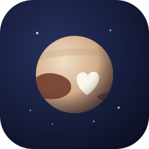
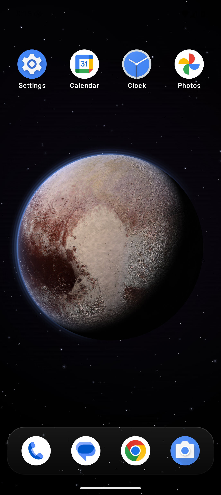
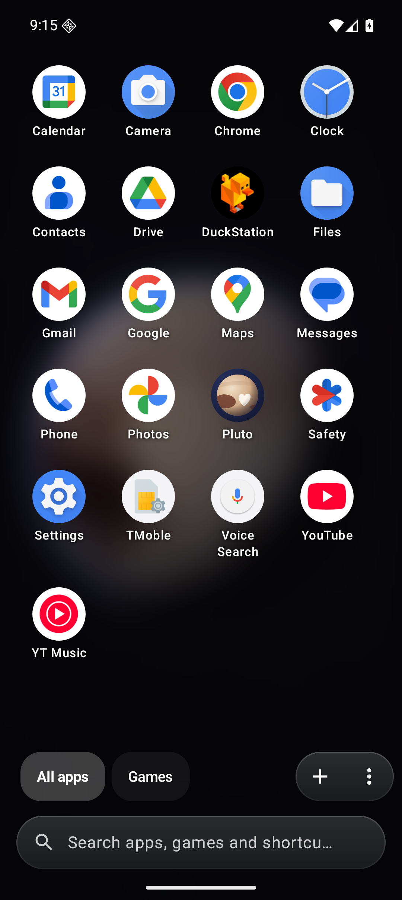
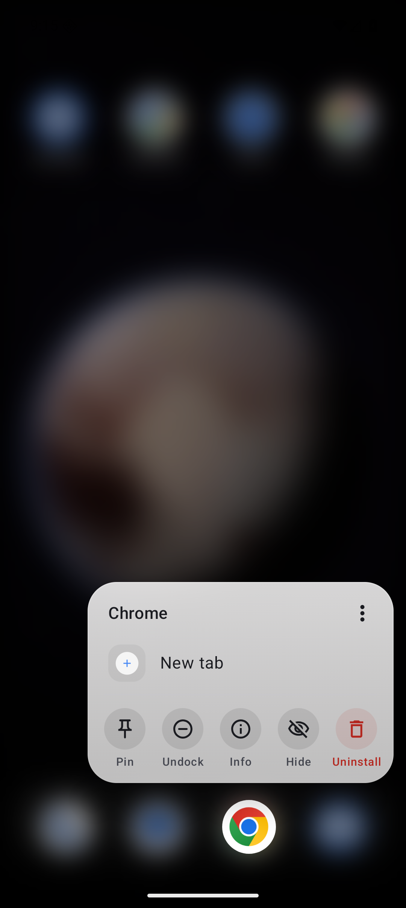
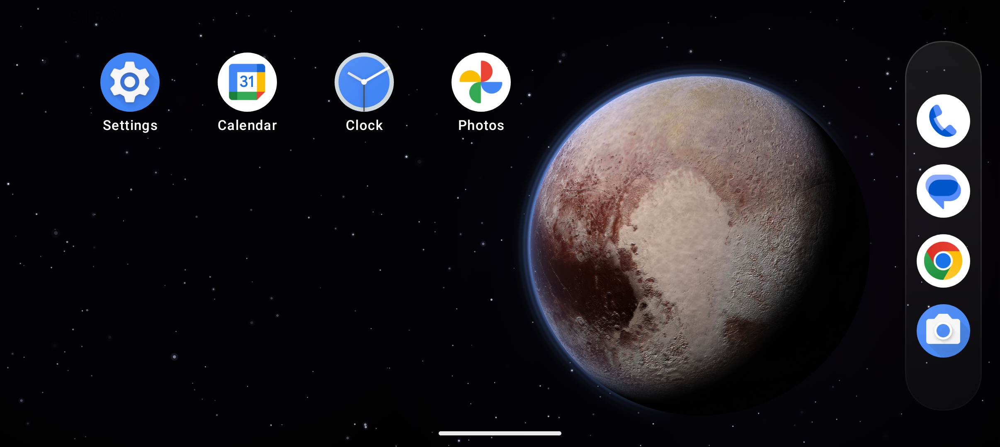
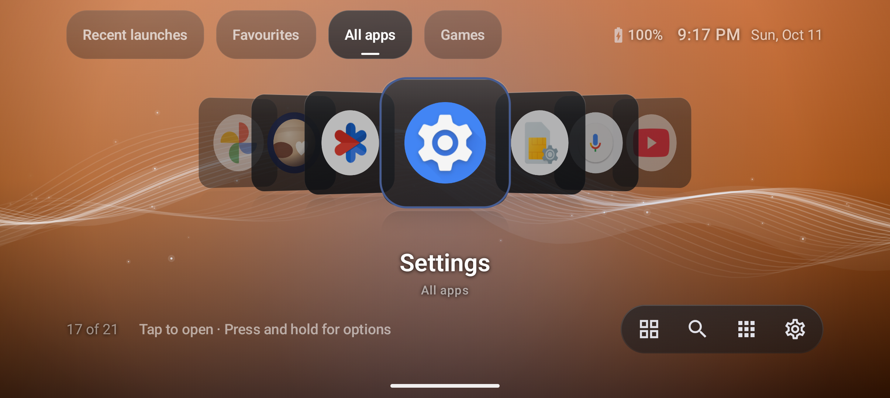
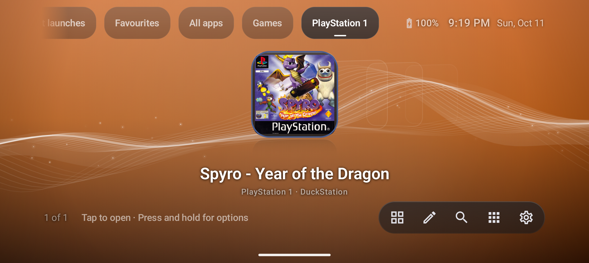
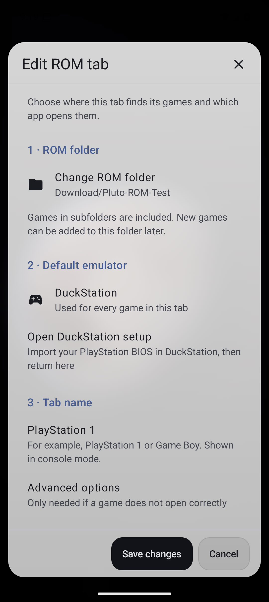
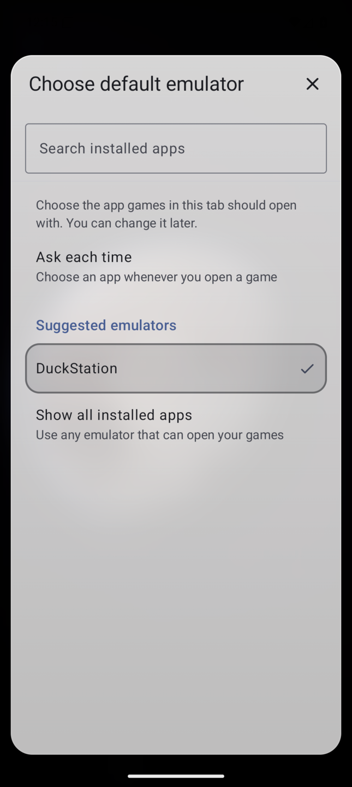

<p align="center">
  
</p>

<h1 align="center">Pluto</h1>

<p align="center">
  <b>One Android home screen for your phone and your handheld.</b><br>
  An everyday launcher in portrait, a comfortable touch layout in landscape,<br>
  and a Coverflow-style console front end when a controller is attached.
</p>

<p align="center">
  <a href="LICENSE"></a>
  
  
  
</p>

---

Pluto is meant to be the one launcher you keep full-time. Rotate the phone or plug in a
gamepad and the presentation adapts, but your apps, favourites, dock, folders and
categories stay exactly the same.

[Privacy policy](https://andershfranzen.github.io/pluto-launcher/privacy/)

<p align="center">
  <a href="https://ko-fi.com/anderslc"></a><br>
  If you like what I do, you can support my work on Ko-fi.
</p>

| Phone | App drawer | Press and hold an app |
| :---: | :---: | :---: |
|  |  |  |

| Landscape | Console mode |
| :---: | :---: |
|  |  |

<sub>Screenshots of Pluto 0.1.5, captured on the Android 16 emulator on October 11, 2026. Home uses the Pluto background; Console mode uses orange XMB waves and the Always in landscape setting. Pluto can also show your wallpaper.</sub>

## Your ROMs, your emulator

Create your own console tabs—**PlayStation 1**, **Game Boy**, or any name you like—and
browse your games in the same Coverflow view as your apps. Select a game to open it in
the emulator you chose for that tab.

<p align="center">
  
</p>

In **Settings → Apps → ROM tabs**, choose your ROM folder, a default emulator and a
tab name. Pluto leaves your files in place, includes subfolders and refreshes the
collection when you return. You can open the emulator's setup and come back to your
unfinished tab, or choose **Ask each time** instead of a default.

**Games and emulators** under a tab lists its games with the app each one opens in, so a
single stubborn game can be sent to a second emulator without changing the rest of the tab.

Pluto offers the folders games usually already sit in — RetroArch, Dolphin, PSP,
DuckStation and the common `ROMs` (ES-DE's default) and `Games` folders — and opens the
picker inside them, rather than leaving you to find them blind. **Diagnostics** under each
tab reports what a check saw: files walked, games found, how many have box art, what was
skipped and by extension, playlists read, tracks a playlist names but cannot find, whether
folder access is still granted, and whether a `gamelist.xml` was read. An empty-looking tab
says why.

| Set up a ROM tab | Choose your default emulator |
| :---: | :---: |
|  |  |

Game names and box art also come from the layouts the big front ends already write: an
EmulationStation `gamelist.xml` kept in the ROM folder (RetroPie, Batocera) supplies names
and artwork, and images are found beside a game, in `boxart/`, `covers/` or `media/` folders
inside the ROM folder, or in RetroArch's
`Named_Boxarts` and `Named_Snaps` sets, including `-thumb`/`-boxart` variants. Nothing is
downloaded or scraped. ES-DE keeps its gamelists and media outside the ROM folder, so they
are not read. Direct launch is implemented for DuckStation; other emulators receive an
Android Open file request. BIOS files and
the emulator's own per-game settings stay in the emulator itself.

Pluto also notices save data: when a battery save or savestate sits beside a game, the
game says so, so it is clear which copy holds your progress. It also remembers when it last
opened each game, so the browse grid's **Recent** order is what you actually played, and
each tile shows the newer of "Played 3 days ago" and its save data's own date.

<sub>The Spyro example uses the maintainer's own disc dump and BIOS. Games, BIOS files,
emulators and cover art are not bundled with Pluto.</sub>

## How it adapts

| Window | Controller | Mode |
| --- | --- | --- |
| Portrait | connected or not | **Phone**: favourites, folders, widgets, dock |
| Landscape | not connected | **Landscape**: the same home, with a wider grid and a side or bottom dock |
| Landscape | connected | **Console**: Coverflow shelves, big titles, button legend |

The mode comes from the window's shape and whether a real gamepad is connected (ordinary
keyboards don't count). Console mode can also be forced on or turned off in Settings.
Pluto never forces rotation on the app you are using.

## Features

**Phone and landscape**
- Favourites grid and folders, plus a five-slot glass dock, shared by every orientation.
  Empty dock slots fold away and come back while you drag an app. The dock takes on the
  colour of the background behind it.
- Press and hold an app for a small menu beside it: the app's own shortcuts (New tab,
  New event, …) and Pin, Dock, Info, Hide and Uninstall, with More… for everything else.
  Press and hold empty space for Search, Add widget, Edit home and Settings.
- A drawer that follows your finger: swipe up anywhere on home. Search and the category
  chips sit at the bottom, under your thumb. It has accent- and case-insensitive search
  and an A–Z fast-scroll rail for longer lists (Settings → Layout → Alphabet rail hides it).
  Type to search apps, games from your ROM
  tabs and Android app shortcuts in labelled sections. Games match titles, filenames and
  tab names; shortcuts match their action or app name. Everything searches across these
  sources; a category searches its apps and shortcuts. Android exposes shortcuts when
  Pluto is your default Home app. No contacts access is required.
- Gestures: choose what a swipe down on Home does (notifications, search or nothing), and
  optionally double-tap empty space to lock the screen.
- Optional iPhone-inspired notification dots: small red dots on app icons and folders,
  including Console app cards. Enable Settings → Apps → Notification dots and allow
  Android notification access. Dots follow active notifications and each channel's badge
  setting; ongoing notifications and group summaries are excluded. Notification contents
  are not stored.
- Categories (All apps, Games and as many of your own as you like); an app can be in several.
- Drag and drop on Home: press, hold and move to rearrange, drop on an app to make a folder,
  onto the dock, or out of the drawer. The explicit Edit mode (Move up / down / before /
  after) still works with touch or a controller.
- Widgets in the home grid (a full row each, resizable in height) and icon packs (the
  ADW / Nova format most packs use).
- Launcher-only hidden apps, with a screen to bring them back.

**Console mode**
- Coverflow: the selected app faces you, with its neighbours tilted away in 3D. It glides
  continuously when you hold the D-pad or stick, and touch can scrub it or fling it.
- Shelves switched with L1/R1: *Recent launches*, *Favourites*, then your categories.
  Each shelf remembers its selection. Settings → Layout → Favourites shelf hides the
  Favourites shelf if you don't want it. Shelves crossfade in place with a subtle 108% entrance;
  Reduce motion keeps their size fixed.
- **Browse shelf** opens an overview grid for apps or ROMs. Touch or controller navigation
  selects an item and returns to its carousel card; Back preserves the previous selection.
  A ROM shelf can be filtered by system when the folder holds several (one `/ROMs` tree),
  filtered to favourites, and sorted by title, most recently played (falling back to when the
  file changed) or file name; long press or X stars a game, and a small badge marks when the
  game was last played, or that save data sits beside it.
- Charcoal glass tabs and controls, gentle card tilt, faint reflections and an ambient
  artwork glow keep the selected game prominent. ROM titles show the tab and default emulator.
- A big title, the position in the shelf, and a button legend that follows focus (Open and
  Actions on a card, Select on tabs and buttons). Without a controller it says how touch works.
- The shelf tabs wrap with the D-pad as with L1/R1, and the whole console mirrors for
  right-to-left languages.
- The **Pluto background**: the dwarf planet from New Horizons' colour map, held still with
  its heart facing you, over a true-black sky (OLED pixels stay off) with twinkling stars,
  drifting dust and the odd shooting star behind it.
- Optional **XMB-style animated background**, in the spirit of the PS3 menu: flowing light ribbons over
  a gradient. Pick a colour, or *Auto*, which changes the colour every month the way the PS3 did. It can
  run in console mode only or everywhere, and becomes a still image with Reduce motion.
- **Add apps** picker for Games, Tools and your own categories, with likely apps suggested first.
- **ROM tabs**: Settings → Apps → ROM tabs creates named console tabs such as
  PlayStation 1. Choose a folder, default emulator and tab name; ROMs use the
  same carousel as apps. Cartridge, disc and computer formats are recognised across
  Nintendo (NES to Switch, including NSP/XCI), Sega, PlayStation, PC Engine, Neo Geo
  Pocket, WonderSwan, Atari, MSX, Commodore, ZX Spectrum and Amstrad systems, plus
  ZIP/7z archives. CUE/M3U/GDI entries group their tracks and discs, and box art comes from
  an adjacent image, a `gamelist.xml` in the ROM folder, `boxart/`/`covers/`/`media/`
  folders or RetroArch's thumbnail folders. Automatic launch supports DuckStation directly;
  other emulators receive an Android Open file request. Each tab has a Diagnostics view that
  explains what a folder check found.
  Emulator search includes any installed app, with likely emulators suggested first.
  Open the chosen emulator from setup to configure it, then return without losing
  your draft. Save stays visible; launch-method overrides live under Advanced options.
  Collections refresh on returning to Pluto (at most once every 30 seconds per tab),
  and Refresh games checks immediately. More games can be copied into the same folder.
  Box art is local; it is not automatically downloaded.

**Controllers**
- D-pad and left-stick navigation with a dead zone, controlled repeat and suppression of
  duplicate inputs.
- Buttons can be remapped per controller, and there is a live diagnostics screen. Home and
  Recents are never remapped.
- A, B, X and Y act as Open, Back, Actions and Search; L1/R1 change category and Start opens
  settings.

**Motion**
- One continuous drawer position drives the panel, the receding home and the scrim,
  whether it moves by finger, button, controller, Back or Home.
- Folders grow from their tile, pages slide on a shared axis, and a single focus ring
  glides between controls.
- Everything uses shared spring and easing tokens and turns instant with
  *Reduce motion* or Android's "Remove animations".

**Privacy**
- Pluto speaks 13 languages: English, Simplified Chinese, Hindi, Spanish, Arabic, French,
  Bengali, Portuguese (Brazil), Russian, Indonesian, Danish, German and Swedish. It follows the
  phone's language, or pick one for Pluto alone in Android 13+'s App languages setting.
  Arabic is mirrored throughout. To add a language, see [docs/LOCALISATION.md](docs/LOCALISATION.md).
- No account, ads, analytics or cloud sync. Normal launcher and ROM features work offline.
- On first launch Pluto asks whether to check GitHub for updates, with automatic checks
  as the default choice. No request is sent until you answer. If allowed, checks run at
  most once a day when you open Pluto. Settings → General → Updates also offers a manual
  check, release notes and Download and update. Downloads require your action; Android
  asks you to approve installation. APK checksums, package/version and signing keys are
  checked before installation so an incompatible update cannot replace your layout.
- If Pluto ever crashes, the trace is kept on this device only: Settings → General → Crash
  reports lists the records and can prefill a GitHub issue for you to review and submit
  yourself. Nothing is sent without that tap, and Clear deletes the records.
- No usage, notification or overlay permissions. Internet access is used for GitHub update
  checks and downloads; Android's Install unknown apps permission is requested only when
  installing an update. Uninstall still uses Android's confirmation, and the notification
  shade permission supports swiping down on Home.
- Double-tap to lock is off by default. Android only lets a launcher lock the screen (without
  disabling fingerprint unlock) through an accessibility service, so turning it on asks you
  to enable "Pluto screen lock". That service performs the lock and nothing else: it listens
  to no events and cannot read what is on screen.
- Recent launches covers only apps opened from Pluto. It can be cleared or switched off,
  and switching it off deletes what was stored.
- Your layout is yours to take with you. Settings → General → Back up layout writes your
  favourites, dock, folders, categories and hidden apps to a file you choose in the system
  picker — Downloads, a cloud folder, a USB stick — and Restore reads it back, here or on
  another device. Pluto needs no storage permission for this: the picker hands it the one
  file. Nothing is uploaded, and the file only moves where you move it.

## Install

Pluto is a 0.1 prototype and isn't on any app store yet. Download the APK from the
[latest GitHub release](https://github.com/andershfranzen/pluto-launcher/releases/latest),
open it on your phone, and choose **Update** (or **Install** for a first installation).
Android may ask you to allow APK installs from your browser.

Version 0.1.4 adds built-in update checks. Install it manually once when coming from
0.1.3 or earlier; future releases can be downloaded from **Settings → General → Updates**.
The first-launch question asks whether to enable automatic checks, and Android still
asks you to approve each installation.

Published builds use the maintainer's local development signing key. A build made on
another machine can have a different key; if Android reports a signing conflict, do
not uninstall a daily-use Pluto build just to bypass it, as that deletes its data —
back up your layout first (Settings → General → Back up layout) and restore it after
reinstalling.

Or build it yourself:

```sh
# JDK 17 and the Android SDK (platform 36) are required; the Gradle wrapper does the rest.
echo "sdk.dir=$ANDROID_HOME" > local.properties

./gradlew assembleRelease
adb install -r app/build/outputs/apk/release/app-release.apk
```

Then press Home and choose Pluto, or let Pluto's first-run setup ask Android for you.
To switch back, open **Settings ▸ Apps ▸ Default apps ▸ Home app**.

Use the **release** build for daily use. It is R8-optimised and ships a baseline profile;
debug builds run largely interpreted and feel noticeably slower. The release build is
signed with your local debug key, so it installs over a debug build and keeps your data.
(On the maintainer's machine it uses the published key instead; see `scripts/dev.sh github-release`.)
To apply the baseline profile at install time, see [docs/SETUP.md](docs/SETUP.md).

## Download stats

See the [daily APK download report](https://github.com/andershfranzen/pluto-launcher/tree/download-stats)
for counts per release and saved daily snapshots. These are GitHub downloads, not unique
users or active installations. Updates and repeat downloads count again. Tracking began
on October 12, 2026; Pluto does not send usage telemetry.

Collection is scheduled through T3 Code daily at 08:00 Europe/Copenhagen while T3 is
running. To capture and publish a snapshot manually, run
`scripts/publish-download-stats.sh` with Python 3 and GitHub push access. History lives
on the separate `download-stats` branch.

## Development

[scripts/dev.sh](scripts/dev.sh) wraps the local loop on a headless emulator (AVD `pluto36`:
API 36, 1080×2412 at 440 dpi like the reference phone, D-pad and keyboard enabled, KVM
accelerated). The SDK lives in `~/Android/Sdk`; `scripts/dev.sh setup` reinstalls it.

```sh
scripts/dev.sh emu start          # boot emulator-5554 headless (emu stop / restart / --wipe)
scripts/dev.sh run                # build debug, install, launch (run release for the R8 build)
scripts/dev.sh ui                 # on-screen text with bounds, for tap targets
scripts/dev.sh shot               # screenshot to captures/
scripts/dev.sh pad DPAD_RIGHT BUTTON_A    # gamepad-source key events (key … for keyboard)
scripts/dev.sh rotate landscape   # portrait | landscape | auto
scripts/dev.sh logcat             # Pluto's process only
scripts/dev.sh doctor             # check SDK, JDK, KVM, AVD, device
scripts/dev.sh github-release     # tests, lint, release APK checked for the published key + .sha256
```

The script runs Gradle on JDK 17 when the default `java` is newer than Gradle supports.

The script always targets `emulator-5554` (override with `PLUTO_SERIAL`). Injected gamepad
keys come from a virtual device, so they exercise key handling but not controller detection
or Handheld mode; those still need hardware ([docs/CONTROLLER_TESTS.md](docs/CONTROLLER_TESTS.md)).

```sh
./gradlew testDebugUnitTest             # JVM tests: modes, search, reorder, stick repeat, Coverflow maths…
ANDROID_SERIAL=emulator-5554 ./gradlew connectedDebugAndroidTest   # Room migrations, repository, UI
ANDROID_SERIAL=emulator-5554 ./gradlew :app:generateBaselineProfile
```

> **Warning:** Gradle's connected-test and baseline-profile tasks install the app on *every*
> attached device and **uninstall it afterwards, deleting its data**. Always set
> `ANDROID_SERIAL` to an emulator. Never run them while the phone you use Pluto on is
> plugged in.

Kotlin and Jetpack Compose, with minSdk 30 and target SDK 36. App discovery and launching go
through `LauncherApps`, organisation lives in Room (with versioned migrations), and preferences
in DataStore. One shared `LauncherViewModel` feeds three layouts. See
[docs/ARCHITECTURE.md](docs/ARCHITECTURE.md).

## Status

Pluto 0.1 is a working prototype, but it isn't finished:

- The acceptance suite and performance targets in [docs/ACCEPTANCE.md](docs/ACCEPTANCE.md)
  have not all been measured on the reference hardware (a 144 Hz OnePlus phone with a
  GameSir controller).
- Work profiles and Private Space are not shown in 0.1. Pluto says so in Settings.
- Layout backup and restore are in Settings → General; widgets and ROM tabs are not part of
  a backup yet (a widget id and a folder grant are both device-specific). App shortcuts need
  Pluto to be the default Home app (Android only shares them with that app).

[docs/KNOWN_ISSUES.md](docs/KNOWN_ISSUES.md) lists the rest, candidly.

## Documentation

- [Setup guide](docs/SETUP.md): install, first launch, default Home, controllers, rotation
- [Architecture](docs/ARCHITECTURE.md): modules, state model, focus, motion, persistence
- [Acceptance tests](docs/ACCEPTANCE.md) and [controller test plan](docs/CONTROLLER_TESTS.md)
- [Known issues](docs/KNOWN_ISSUES.md)

## Licence

[MIT](LICENSE) © 2026 Pluto contributors. The logo is original artwork made for this project.
Game artwork visible in demonstration screenshots belongs to its respective owners;
the MIT licence does not apply to it. Please don't contribute proprietary game artwork
as app assets or other unlicensed assets.

Performance changes and diagnostic measurements are documented in [docs/PERFORMANCE_REVIEW.md](docs/PERFORMANCE_REVIEW.md).
